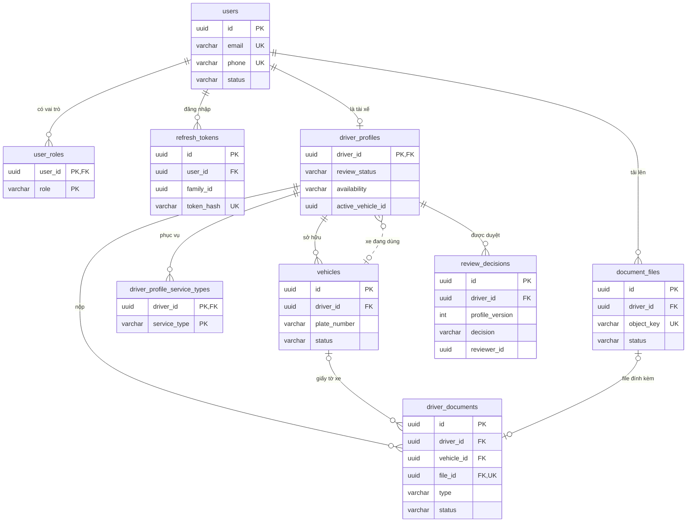
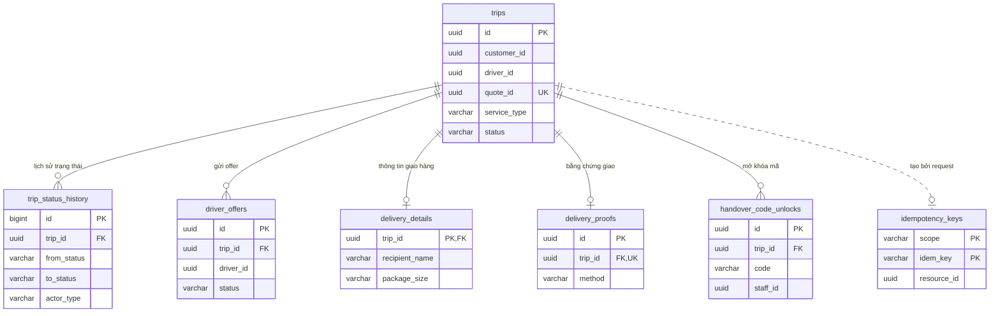
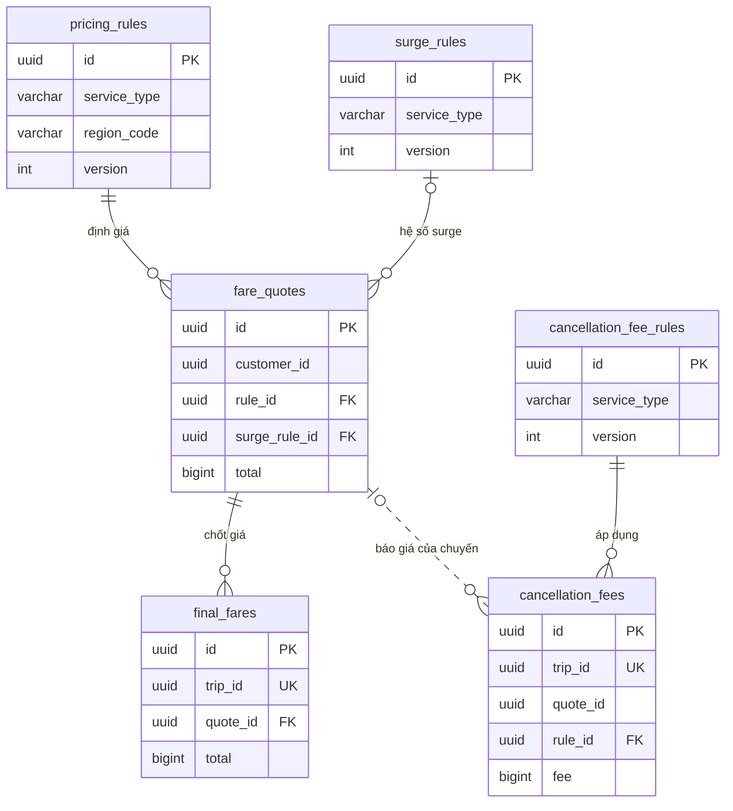
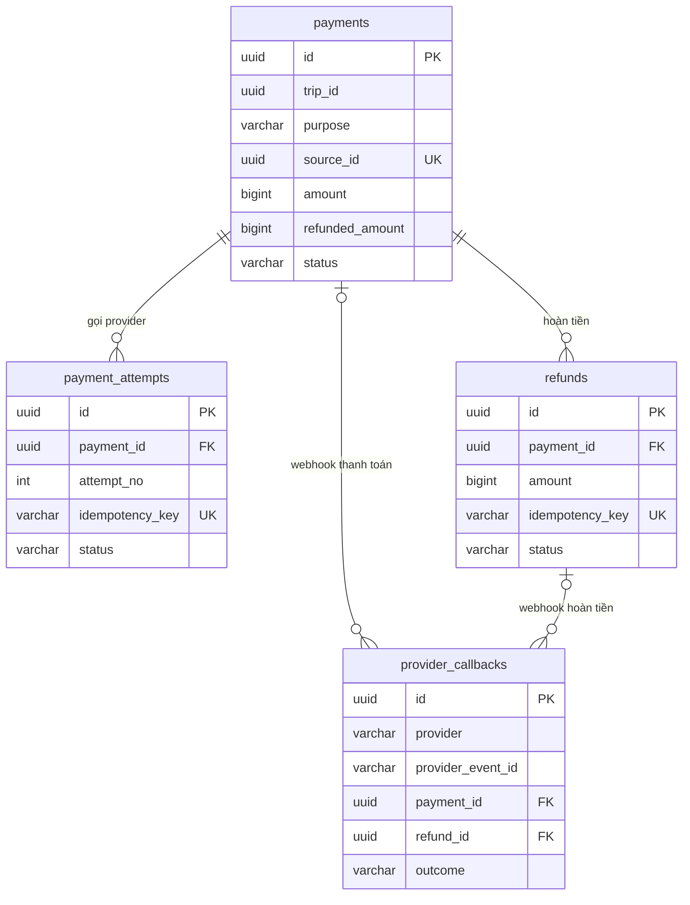
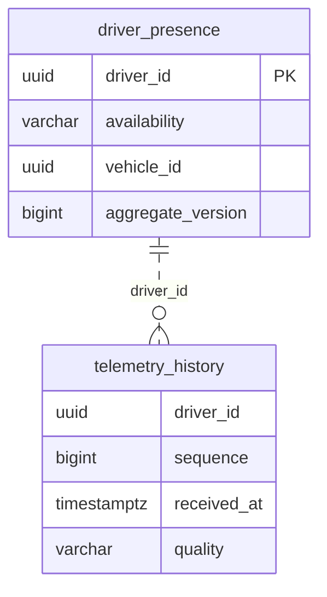
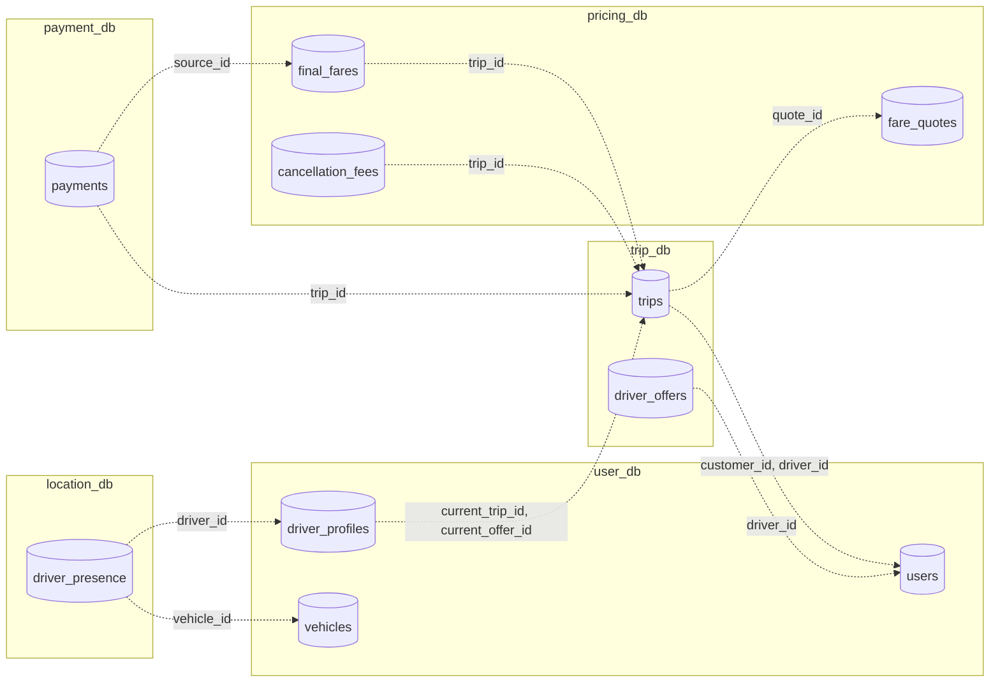

# Thiết kế cơ sở dữ liệu (database per service)

Tài liệu này mô tả các bảng của từng database và **mối quan hệ giữa các bảng**. Nguồn sự thật là Flyway migration trong `services/<service>/src/main/resources/db/migration/`; khi migration đổi thì cập nhật tài liệu này theo.

| Database | Service | Migration hiện tại |
|---|---|---|
| `user_db` | user-service | V1–V5 |
| `trip_db` | trip-service | V1–V6 |
| `pricing_db` | pricing-service | V1–V5 |
| `payment_db` | payment-service | V1–V4 |
| `location_db` | location-service | V1–V2 |

api-gateway, realtime-gateway và eureka-server không có database quan hệ. Vị trí trực tiếp, mã OTP, bộ đếm surge và phiên WebSocket nằm ở Redis (README §4.6).

## 1. Nguyên tắc chung

- **Mỗi service một database, một user DB riêng.** Service này không đọc hay ghi vào database của service khác.
- **Khóa ngoại (FK) chỉ tồn tại trong cùng một database.** Liên kết sang database khác là **tham chiếu logic** bằng UUID, không có FK. Dữ liệu được đồng bộ qua sự kiện Kafka (mục 7).
- ID là UUIDv7, thời gian là `TIMESTAMPTZ` (UTC), tiền là `BIGINT` theo VND, trạng thái là `VARCHAR + CHECK`, khóa lạc quan bằng cột `version`.
- Bảng lịch sử, bằng chứng và audit là **append-only**: trigger chặn `UPDATE` và `DELETE`.

**Ký hiệu bản số** trong bảng quan hệ:

| Ký hiệu | Nghĩa |
|---|---|
| 1 – 0..1 | Một bản ghi cha có không hoặc một bản ghi con |
| 1 – 0..n | Một bản ghi cha có không hoặc nhiều bản ghi con |
| 0..1 – 0..n | FK cho phép NULL: bản ghi con có thể không gắn với cha nào |

Trong sơ đồ mermaid, nét liền là quan hệ có FK, nét đứt là quan hệ logic không có FK. Sơ đồ chỉ ghi khóa và cột liên kết; cột đầy đủ xem trong migration.

## 2. `user_db` (user-service)

Tài khoản, vai trò, phiên đăng nhập và hồ sơ tài xế (xe, giấy tờ, kết quả duyệt). Đây là nguồn gốc của trạng thái sẵn sàng của tài xế.

| Bảng cha | Bảng con | Cột liên kết | Bản số | Loại | Ghi chú |
|---|---|---|---|---|---|
| `users` | `user_roles` | `user_roles.user_id` | 1 – 0..n | FK | PK ghép `(user_id, role)`: một user không có trùng vai trò. Code tạo user luôn kèm ít nhất một vai trò |
| `users` | `refresh_tokens` | `refresh_tokens.user_id` | 1 – 0..n | FK | Mỗi lần đăng nhập một token; token xoay vòng trong cùng `family_id` |
| `users` | `driver_profiles` | `driver_profiles.driver_id` | 1 – 0..1 | FK, dùng chung PK | Quan hệ 1–1 tùy chọn: chỉ tài khoản tài xế mới có hồ sơ, `driver_id` = `users.id` |
| `users` | `document_files` | `document_files.driver_id` | 1 – 0..n | FK | File được tải lên trước khi gắn vào giấy tờ |
| `driver_profiles` | `driver_profile_service_types` | `driver_profile_service_types.driver_id` | 1 – 0..n | FK | PK ghép `(driver_id, service_type)`: RIDE, DELIVERY |
| `driver_profiles` | `vehicles` | `vehicles.driver_id` | 1 – 0..n | FK | Biển số unique trong các xe `ACTIVE` |
| `driver_profiles` | `driver_documents` | `driver_documents.driver_id` | 1 – 0..n | FK | Mỗi loại giấy tờ chỉ một bản `ACTIVE`, bản cũ chuyển `REPLACED` |
| `vehicles` | `driver_documents` | `driver_documents.vehicle_id` | 0..1 – 0..n | FK, cho phép NULL | CHECK: giấy tờ xe (đăng ký, bảo hiểm) bắt buộc có `vehicle_id`, giấy tờ cá nhân thì không |
| `document_files` | `driver_documents` | `driver_documents.file_id` | 0..1 – 0..1 | FK, UNIQUE, cho phép NULL | Một file chỉ đính kèm cho một giấy tờ |
| `driver_profiles` | `review_decisions` | `review_decisions.driver_id` | 1 – 0..n | FK | Append-only; `profile_version` ghi phiên bản hồ sơ được duyệt |
| `vehicles` | `driver_profiles` | `driver_profiles.active_vehicle_id` | 0..1 – 0..n | Logic | Xe tài xế chọn khi online, không đặt FK |
| `users` | `review_decisions` | `review_decisions.reviewer_id` | 1 – 0..n | Logic | Quản trị viên đã duyệt |

`driver_profiles.current_offer_id`, `current_trip_id` và `accepted_offer_id` trỏ sang `trip_db` (mục 7).

## 3. `trip_db` (trip-service)

Chuyến đi và giao hàng: vòng đời trạng thái, offer cho tài xế, thông tin người nhận, mã giao nhận.

| Bảng cha | Bảng con | Cột liên kết | Bản số | Loại | Ghi chú |
|---|---|---|---|---|---|
| `trips` | `trip_status_history` | `trip_status_history.trip_id` | 1 – 0..n | FK | Append-only; mỗi lần chuyển trạng thái một dòng |
| `trips` | `driver_offers` | `driver_offers.trip_id` | 1 – 0..n | FK | Mỗi chuyến chỉ một offer `PENDING` tại một thời điểm (partial unique index) |
| `trips` | `delivery_details` | `delivery_details.trip_id` | 1 – 0..1 | FK, dùng chung PK | Chỉ chuyến `DELIVERY` mới có |
| `trips` | `delivery_proofs` | `delivery_proofs.trip_id` | 1 – 0..1 | FK, UNIQUE | Append-only; mỗi chuyến giao hàng tối đa một bằng chứng |
| `trips` | `handover_code_unlocks` | `handover_code_unlocks.trip_id` | 1 – 0..n | FK | Append-only; mỗi lần quản trị viên mở khóa mã một dòng |
| `trips` | `idempotency_keys` | `idempotency_keys.resource_id` | 1 – 0..1 | Logic | Gửi lại cùng `Idempotency-Key` trả về đúng chuyến đã tạo |

Ràng buộc nghiệp vụ ở mức DB: mỗi tài xế chỉ một chuyến đang chạy, mỗi khách chỉ một chuyến đang mở, mỗi tài xế chỉ giữ một offer `PENDING` (đều là partial unique index theo trạng thái).

## 4. `pricing_db` (pricing-service)

Bảng giá có phiên bản, quy tắc surge, báo giá, giá chốt khi hoàn thành và phí hủy.

| Bảng cha | Bảng con | Cột liên kết | Bản số | Loại | Ghi chú |
|---|---|---|---|---|---|
| `pricing_rules` | `fare_quotes` | `fare_quotes.rule_id` | 1 – 0..n | FK | Báo giá giữ cả `rule_version` để tính lại được giá |
| `surge_rules` | `fare_quotes` | `fare_quotes.surge_rule_id` | 0..1 – 0..n | FK, cho phép NULL | NULL khi không tính surge (`surge_source` = NONE hoặc UNAVAILABLE) |
| `fare_quotes` | `final_fares` | `final_fares.quote_id` | 1 – 0..n | FK | Thực tế 1 – 0..1: một báo giá chỉ đặt được một chuyến, và `final_fares.trip_id` unique |
| `cancellation_fee_rules` | `cancellation_fees` | `cancellation_fees.rule_id` | 1 – 0..n | FK | Lưu cả `rule_version` |
| `fare_quotes` | `cancellation_fees` | `cancellation_fees.quote_id` | 0..1 – 0..n | Logic | Chuyến tạo trước khi có báo giá thì NULL |

Các bảng quy tắc (`pricing_rules`, `surge_rules`, `cancellation_fee_rules`) không bao giờ bị sửa: phiên bản mới đóng phiên bản cũ bằng `effective_to`. Ràng buộc `EXCLUDE USING gist` cấm hai quy tắc cùng loại có khoảng hiệu lực chồng nhau.

## 5. `payment_db` (payment-service)

Chỉ ghi nhận thanh toán của khách thành công hay thất bại, các lần gọi provider, webhook và hoàn tiền. **Ví tài xế, thu nhập và hoa hồng không lưu ở đây**: nhà cung cấp thanh toán (bên thứ ba mô phỏng) quản lý. Các bảng ví cũ đã bị xóa ở Flyway V4.

| Bảng cha | Bảng con | Cột liên kết | Bản số | Loại | Ghi chú |
|---|---|---|---|---|---|
| `payments` | `payment_attempts` | `payment_attempts.payment_id` | 1 – 0..n | FK | `UNIQUE (payment_id, attempt_no)`; `idempotency_key` gửi sang provider nên thử lại không trừ tiền hai lần |
| `payments` | `refunds` | `refunds.payment_id` | 1 – 0..n | FK | Tổng hoàn ≤ số đã thu (CHECK trên `payments.refunded_amount`); mỗi payment chỉ một refund `PENDING` |
| `payments` | `provider_callbacks` | `provider_callbacks.payment_id` | 0..1 – 0..n | FK, cho phép NULL | NULL khi callback không khớp lần thu nào (bị từ chối) |
| `refunds` | `provider_callbacks` | `provider_callbacks.refund_id` | 0..1 – 0..n | FK, cho phép NULL | Callback `refund.succeeded` / `refund.failed` |

`UNIQUE (trip_id, purpose)` trên `payments`: mỗi chuyến chỉ một khoản thu cước và một khoản thu phí hủy. `UNIQUE (provider, provider_event_id)` trên `provider_callbacks`: webhook gửi lặp chỉ được ghi một lần.

## 6. `location_db` (location-service)

Vị trí hiện tại nằm trong Redis (GEO index). PostgreSQL giữ dữ liệu để dựng lại Redis và lịch sử GPS.

| Bảng cha | Bảng con | Cột liên kết | Bản số | Loại | Ghi chú |
|---|---|---|---|---|---|
| `driver_presence` | `telemetry_history` | `telemetry_history.driver_id` | 1 – 0..n | Logic | Không đặt FK: `telemetry_history` được partition theo ngày và xóa nguyên phân vùng khi hết hạn lưu trữ; vị trí có thể đến trước sự kiện trạng thái |

`driver_presence` là projection của sự kiện `DriverAvailabilityChanged` từ user-service; `aggregate_version` loại sự kiện cũ hoặc phát lại.

## 7. Liên kết giữa các database

Không có FK nào đi qua hai database. Bảng dưới liệt kê các tham chiếu logic và cách dữ liệu được đưa sang.

| Cột | Trỏ tới | Dữ liệu đi sang bằng |
|---|---|---|
| `trip_db.trips.customer_id`, `driver_id`; `driver_offers.driver_id` | `user_db.users.id` | Lấy từ JWT của người gọi và từ kết quả ghép tài xế |
| `trip_db.trips.quote_id` | `pricing_db.fare_quotes.id` | trip-service gọi `GET /internal/v1/quotes/{id}` rồi chép snapshot giá vào `trips` |
| `user_db.driver_profiles.current_offer_id`, `current_trip_id`, `accepted_offer_id` | `trip_db.driver_offers.id`, `trips.id` | Sự kiện `dispatch.offers.v1`, `trip.events.v1` |
| `pricing_db.final_fares.trip_id`, `cancellation_fees.trip_id` | `trip_db.trips.id` | Sự kiện `TripCompleted`, `TripCancelled` (`trip.events.v1`) |
| `payment_db.payments.trip_id` | `trip_db.trips.id` | Đi kèm sự kiện giá của pricing-service |
| `payment_db.payments.source_id` | `pricing_db.final_fares.id` (khi `purpose` = TRIP_FARE) hoặc `cancellation_fees.id` (khi CANCELLATION_FEE) | Sự kiện `FareFinalized`, `CancellationFeeCalculated` (`pricing.events.v1`) |
| `location_db.driver_presence.driver_id`, `vehicle_id` | `user_db.driver_profiles.driver_id`, `vehicles.id` | Sự kiện `DriverAvailabilityChanged` (`driver.events.v1`) |
| `*.audit_records.actor_id`, `review_decisions.reviewer_id`, `handover_code_unlocks.staff_id`, `refunds.requested_by`, `pricing_rules.created_by` | `user_db.users.id` (quản trị viên) | Lấy từ JWT của người thao tác |

Vì không có FK xuyên database, tính nhất quán dựa vào:

- **Transactional Outbox:** service nguồn ghi sự kiện vào `outbox_events` trong cùng transaction với dữ liệu nghiệp vụ, relay đẩy lên Kafka sau.
- **Idempotent Consumer:** service nhận ghi `(consumer, event_id)` vào `processed_events`; sự kiện giao lặp bị bỏ qua.
- **Khóa nghiệp vụ duy nhất:** `final_fares.trip_id`, `cancellation_fees.trip_id`, `payments (trip_id, purpose)`, `payments.source_id` đều unique, nên dù sự kiện trùng cũng không tạo hai bản ghi.

## 8. Bảng hạ tầng dùng chung

Các bảng này có cùng cấu trúc ở mỗi database và không có quan hệ với bảng nghiệp vụ.

| Bảng | Vai trò | Có ở |
|---|---|---|
| `outbox_events` | Sự kiện chờ đẩy lên Kafka (Transactional Outbox) | user, trip, pricing, payment |
| `processed_events` | Sự kiện đã xử lý, PK `(consumer, event_id)` | user, pricing, payment, location |
| `audit_records` | Nhật ký thao tác nhạy cảm của quản trị viên, append-only | user, trip, pricing, payment |
| `idempotency_keys` | Header `Idempotency-Key` của API tạo chuyến | trip |
